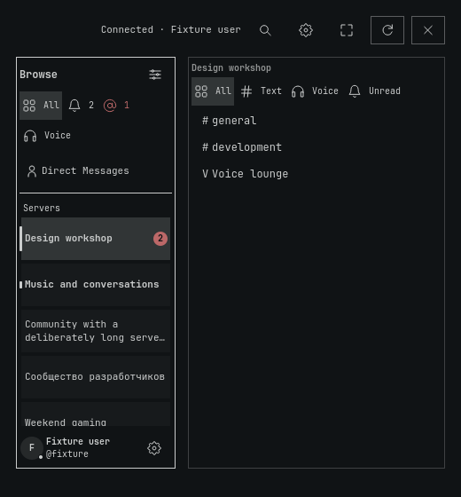

# Omacord

A text-focused Discord client for Omarchy Quattro, with a native panel, channel switcher, mention indicator, voice controls and an experimental camera and screen viewer. Plugin ID: `quickshell.discord`.

[Download testing releases](https://github.com/PavelLizunov/omarchy-discord/releases)

Linux x86_64 on Omarchy Quattro. Other architectures require a source build.

The plugin runs with your user permissions inside the shared Omarchy shell. The backend connects to Discord, stores a sign-in token through Secret Service, and uses a user systemd service. This is an unofficial client; use it at your own risk.



Linux offscreen QML render with sample data, not a live-account screenshot.

## Sign-in in beta.3

Use QR login with the Discord mobile app, or a Discord user token. The masked field is not a password field; email/password sign-in is not implemented. QR login now has separate Back to sign-in and Try again actions. A Discord CAPTCHA requirement is reported explicitly, but cannot be completed inside Omacord. The reported remote password screen and HTTP 400 cause remain unresolved until the exact screen and response are available.

## Requirements and installation

Requires Omarchy Quattro, Quickshell, Qt Quick Controls, systemd, `secret-tool`, `libopus`, `rsync` and `jq`. Experimental video viewing additionally requires `ffmpeg`. Clipboard image staging uses `wl-paste`. The bundled backend is for x86_64; other architectures or changed backend sources require Go and build dependencies. Source builds may download Go modules. Never start a second Quickshell instance to run the plugin.

From this checkout:

```sh
bash scripts/install-local.sh --section right
```

This validates the plugin, installs the backend and user unit, copies source into `~/.config/omarchy/plugins/quickshell.discord`, rescans plugins and enables the widget if needed. It can restart an existing backend. The installer mirrors the destination with deletion, so back up local installed-copy changes before using it. The unit is not enabled at login by setup; the plugin manages its lifecycle.

For updates, rerun the installer after preserving drafts and local changes. A shell reload may be necessary when cached QML remains loaded; preserve unsent work in other plugins before a shell restart.

## What works and what is experimental

Text channels, direct messages, server navigation and voice controls are the core client. Video viewing is experimental: H.264 only, at most 5 JPEG updates per second. Live screen reception has bounded evidence; webcam reception, long-running voice recovery and physical audio acceptance remain incomplete. Read the [release scope](docs/releases.md) before choosing a build.

## Documentation

- [Using the client and audio controls](docs/usage.md)
- [Checks and troubleshooting](docs/checks.md)
- [Safe removal](docs/removal.md)
- [Release notes](CHANGELOG.md) and [historical verification](docs/verification.md)
- [Development contract](docs/development.md)

## License

MIT. See [LICENSE](LICENSE). The [voice transport license](backend/internal/voicewire/LICENSE) and patch provenance remain bundled.
